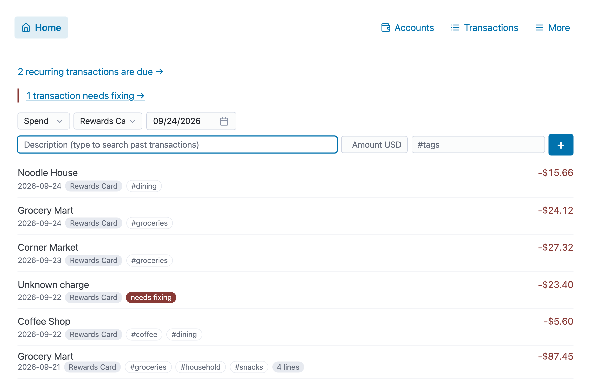
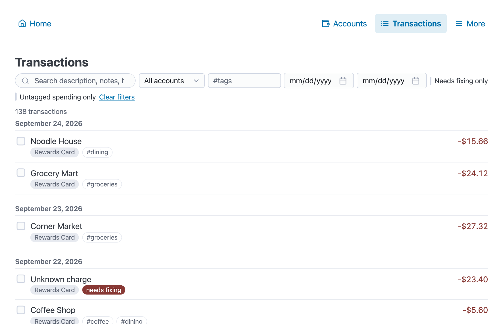
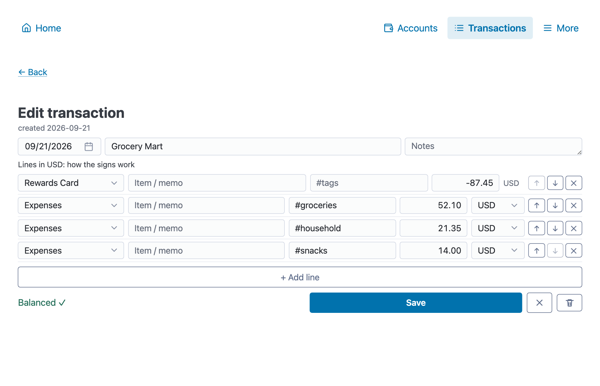
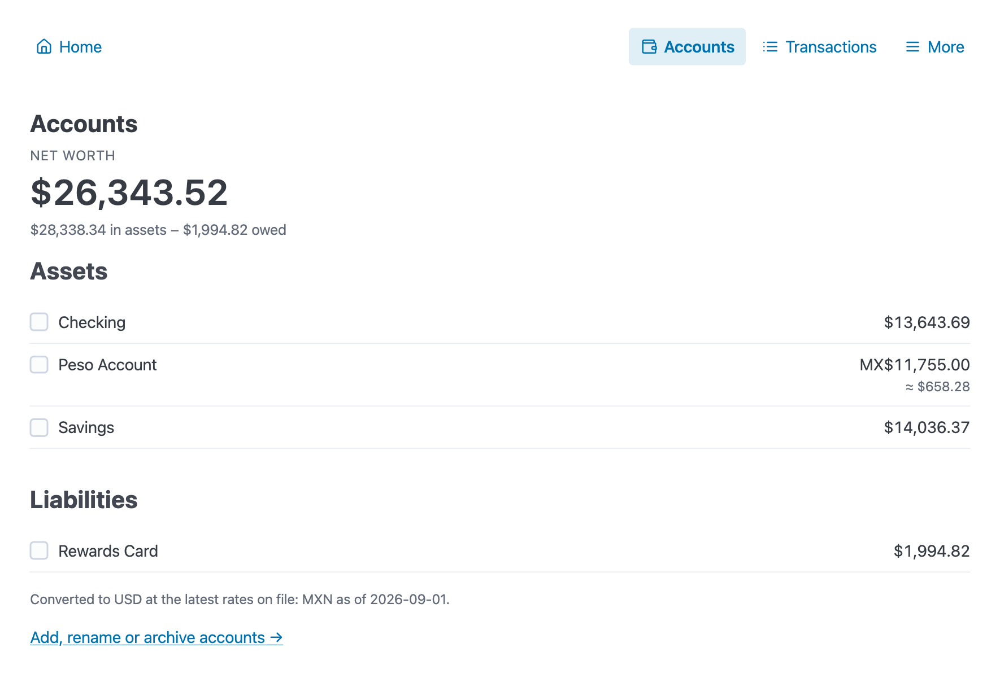
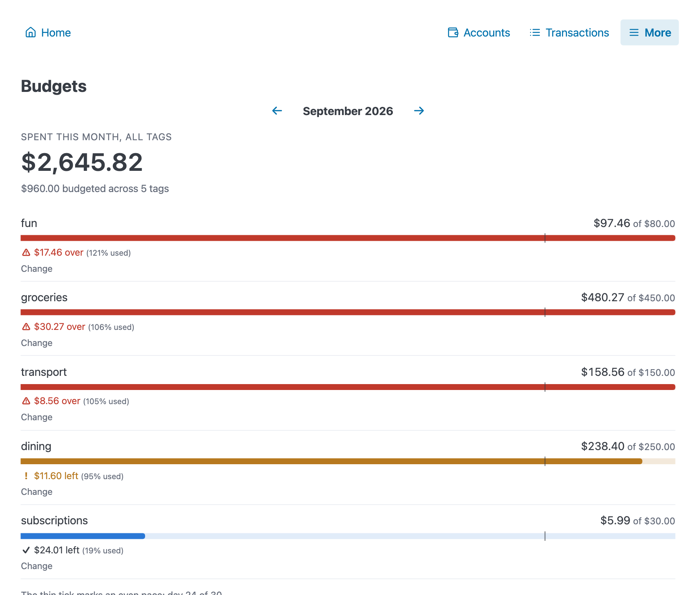
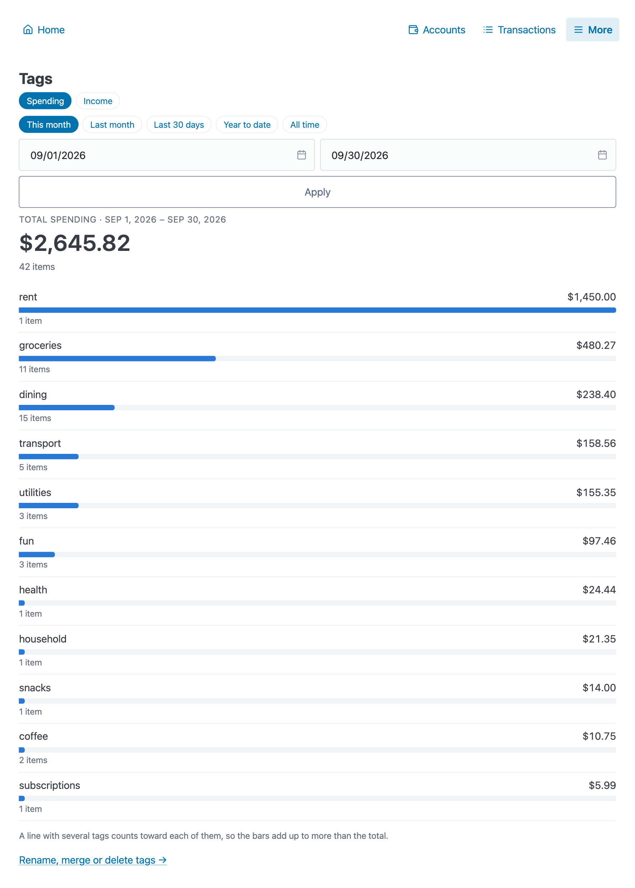
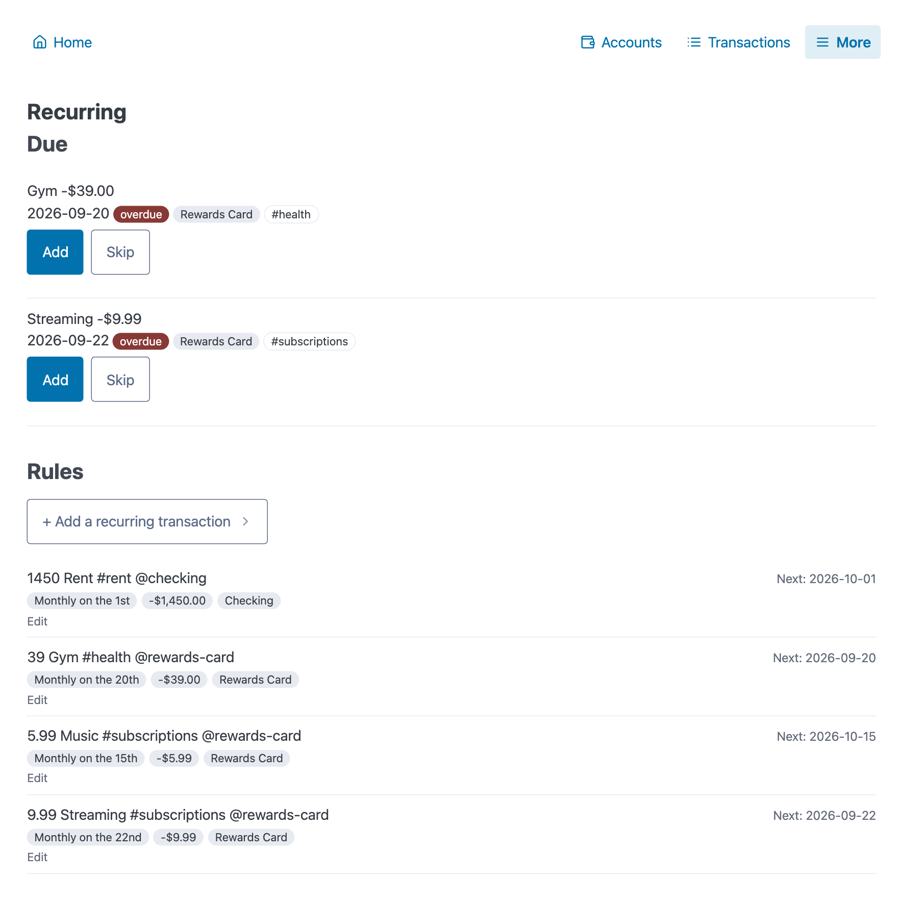
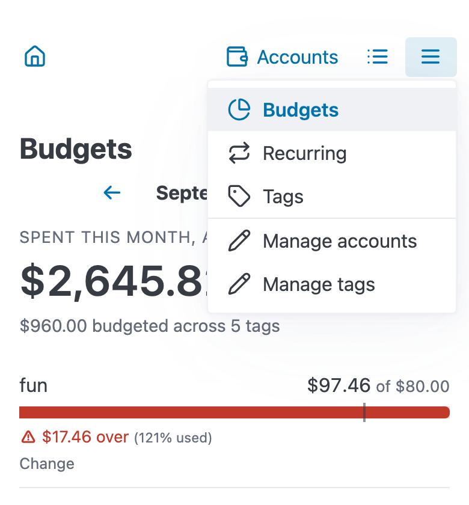
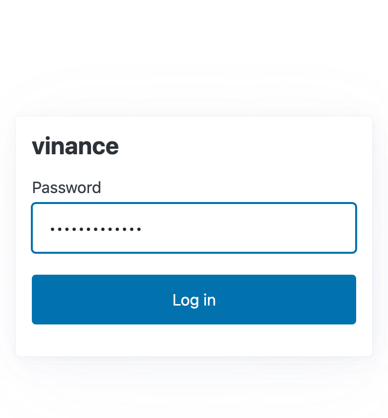

# vinance

[](https://github.com/amascii/vinance/actions/workflows/ci.yml)

A simple, fast personal finance tracker for one person: a lighter alternative to GnuCash that runs on your own machine.
Go + [chi](https://github.com/go-chi/chi) + [templ](https://templ.guide) + [htmx](https://htmx.org), with SQLite for storage.

> The screenshots below use invented demo data. Regenerate them with `make screenshots`.



## Contents

- [Features](#features)
- [Finding your way around](#finding-your-way-around)
- [Running it](#running-it)
- [Development](#development)
- [License](#license)

## Features

- **Fast entry.** One form for spending, income and transfers, with autocomplete from your past transactions that fills in the usual account, amount and tags.
- **Tags instead of expense categories.** Tag a line `#groceries #coffee`; reports and budgets sum by tag. A transaction can carry several.
- **Split transactions.** Break one statement line (a store receipt) into item lines, each with its own memo and tags. A live indicator shows what is still unallocated.
- **Double-entry under the hood.** Every transaction's splits sum to zero and the editor refuses to save one that doesn't, so balances always add up. Money booked to an Imbalance account shows up as "needs fixing" until you categorise it.
- **Multi-currency.** Each account has one currency; cross-currency transactions keep both the amount and the value. Balances and net worth are converted to USD with stored rates.
- **Budgets and recurring entries.** Monthly budgets per tag with an even-pace marker, and recurring rules that wait for you to Add or Skip each due occurrence (nothing is created behind your back).
- **Bulk tag editing, filters and search** across the whole history, with infinite scroll. Transactions are grouped under a heading for each day.
- **Navigation that stays out of the way.** **Home** (the house, top left) is the entry form; **Accounts** and **Transactions** are always visible on the right; **More** (☰) holds Budgets, Recurring, Tags, Manage accounts and Manage tags. Every item has an icon and the current page is highlighted. On a phone the bar shrinks to icons on a single row (see [Finding your way around](#finding-your-way-around)).
- **Money is exact.** Amounts are integer minor units end to end; there is no floating point anywhere near a balance.

| Transactions | Split editor |
|---|---|
|  |  |

| Accounts and net worth | Budgets |
|---|---|
|  |  |

| Spending by tag | Recurring |
|---|---|
|  |  |

## Finding your way around

| In the top bar | Page |
|---|---|
| **Home** | Quick-entry form, recent transactions, and a banner when recurring entries are due |
| **Accounts** | Balances and net worth |
| **Transactions** | Full history with filters, search and bulk tag editing |
| **More → Budgets** | Monthly budgets per tag |
| **More → Recurring** | Due and scheduled recurring entries |
| **More → Tags** | Spending by tag |
| **More → Manage accounts** | Add, rename, archive or delete accounts |
| **More → Manage tags** | Rename, merge or delete tags |

On a phone the bar stays at the top as a single row of icons (only Accounts keeps its label), and the More menu opens below it:



## Running it

You need Go (see `go.mod` for the version). There is nothing else to install: SQLite is compiled in.

```sh
git clone https://github.com/amascii/vinance.git
cd vinance
make run          # http://127.0.0.1:8080
make run-lan      # same, but reachable from your phone/other computers on the same Wi-Fi (http://<your-lan-ip>:8080); needs a login, see below
```

The database is created and migrated on first start at `./data/vinance.db`. `data/` is gitignored, so your numbers never end up in the repo.
Add your first account under **More → Manage accounts**, then use the form on **Home**.

| Variable | Default | |
|---|---|---|
| `VINANCE_DB` | `./data/vinance.db` | SQLite file |
| `VINANCE_ADDR` | `127.0.0.1:8080` | listen address |
| `LOG_LEVEL` | `info` | `debug`, `info`, `warn`, `error` (logs are JSON) |
| `VINANCE_PASSWORD_HASH` | (none) | bcrypt hash of your password; turns the login on |
| `VINANCE_SECURE_COOKIES` | `false` | set `true` when you reach the app over HTTPS |

### Login

By default there is no login, and the server refuses to listen on anything but `localhost` in that state. To use it from a phone or another machine,
set a password:

```sh
go run ./cmd/vinance hash-password        # asks for a password, prints a bcrypt hash
VINANCE_PASSWORD_HASH='<paste the hash>' make run-lan     # single quotes: the hash contains $
```

Every page then asks for the password; you stay logged in for 30 days and can log out under **More → Log out**. Failed logins are
throttled. There is no reset: make a new hash and restart. A login is one layer, so for use away from home still put the app behind
something private such as Tailscale and serve it over HTTPS (with `VINANCE_SECURE_COOKIES=true`).



### Running as a service (macOS)

To keep it running in the background on a Mac and reach it from your phone through [Tailscale](https://tailscale.com):

```sh
make service-install    # builds, copies data/vinance.db, writes the LaunchAgent, starts it (asks for your password hash)
tailscale serve --bg 8787   # publishes it, to your own devices only, at https://<mac-name>.<tailnet>.ts.net
```

The service listens on `127.0.0.1:8787` (so `make run` on 8080 still works beside it), keeps its own database in
`~/Library/Application Support/vinance/` (the repo's `data/` is only copied from, never used) and logs JSON to `~/Library/Logs/vinance/vinance.log`.
It starts when you log in and restarts if it crashes. It sets `VINANCE_SECURE_COOKIES=true`, so open it over HTTPS (the Tailscale URL).
Never use `tailscale funnel`: that makes it public.

| | |
|---|---|
| `make deploy` | after merging to `main`: pull, then this builds `main`, backs up the database, restarts, and rolls back the binary if the new build doesn't come up healthy |
| `make service-status` | is it loaded, does `/healthz` answer |
| `make service-uninstall` | stops it and removes the LaunchAgent; your data stays |

The password hash is stored in `~/Library/LaunchAgents/com.amascii.vinance.plist` (mode 600). The Mac must not sleep: the app is down while it does.

## Development

```sh
make test             # unit + HTTP feature tests
make e2e-install      # one-time: download Chromium for Playwright
make e2e              # browser journeys
make generate         # after editing *.templ or internal/db/queries/*.sql (generated code is committed)
make screenshots      # regenerate docs/screenshots from synthetic data
```

Tests use small synthetic fixtures only. [`PROJECT.md`](PROJECT.md) holds the design decisions, data model and task log;
[`CLAUDE.md`](CLAUDE.md) holds the working rules and hard-won gotchas.

## License

[MIT](LICENSE)
